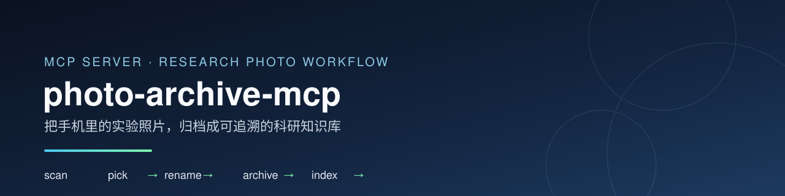
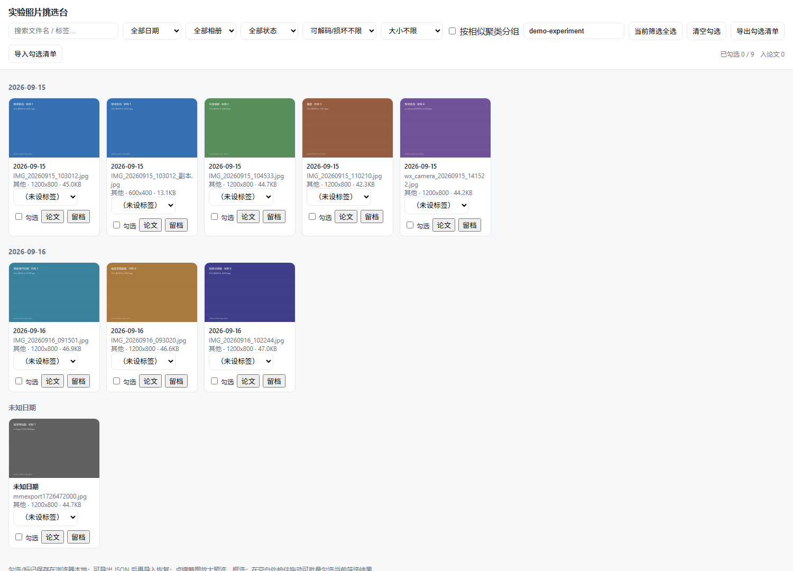

<div align="center">



**Turn your phone's lab photos into a searchable, traceable research archive.**

Scan → pick in a local web page → rename & archive by date → index and verify. Runs fully offline, exposes 17 MCP tools for Claude, Cursor, Codex and other clients.

[](https://github.com/gaoanze/photo-archive-mcp/actions/workflows/test.yml)
[](docs/USAGE.zh-CN.md)
[](#features)
[](#quick-start)
[](#why)
[](LICENSE)
[](pyproject.toml)

[中文](README.md) · [Full manual (CN)](docs/USAGE.zh-CN.md) · [Issues](https://github.com/gaoanze/photo-archive-mcp/issues)

</div>

## Why

After months of bench work your phone gallery is a pile of photos: bench shots, instrument readings, spectra, spreadsheet screenshots, WeChat transfers. Finding the right one for a paper figure — and remembering which day and which batch it belongs to — is painful.

`photo-archive-mcp` turns that pile into a deterministic archive: one folder per day (`YYYY-MM-DD-summary`), one file per photo (`date-tag-index.jpg`), plus manifests, indexes, comparison reports and knowledge-base mappings. Everything stays on your machine.

## Features

- **Phone import** — Windows MTP/WPD with resume, or copy from local photo folders on macOS/Linux.
- **One-page picker** — a single offline HTML file with thumbnails, filters (date / album / size / broken), rubber-band multi-select, and JSON export/import of selection state.
- **Deterministic archiving** — SHA-1 dedupe, pHash clustering of near-duplicates, broken-file list, EXIF date fallback, HEIC handling.
- **Traceable output** — manifest, rollback list, comparison report, photo index, keyword lookup.
- **Lab workflows** — cross-experiment ledger, knowledge-base target mapping, and a paper-figure list with automatic `Fig.01` numbering.
- **MCP native** — 17 tools callable from any MCP client; no network calls, no uploads.

## Demo

The generated picker (synthetic sample images, including one near-duplicate and one photo without a recognizable date):



## Quick start

```bash
git clone https://github.com/gaoanze/photo-archive-mcp.git
cd photo-archive-mcp
python -m venv .venv
.venv\Scripts\activate          # Windows (# source .venv/bin/activate on macOS/Linux)
pip install -e .                # add ".[phone]" on Windows to import from a phone
```

MCP client config (stdio):

```json
{
  "mcpServers": {
    "photo-archive": {
      "command": "photo-archive-mcp",
      "args": []
    }
  }
}
```

Try it without a client:

```bash
python examples/selftest.py
python examples/cli_demo.py --source ./photos --out ./archive_ready
```

## Tools (17)

| Stage | Tool | What it does |
| --- | --- | --- |
| Import | `list_phone_devices`, `clone_phone_photos` | List and copy photos from a phone (Windows MTP) or a local folder |
| Scan | `scan_photos` | Metadata, fingerprints, thumbnails, duplicates and broken files |
| Pick | `build_selection_page` | Generate the offline picker page |
| Plan | `build_archive_plan`, `preview_archive_plan` | Merge selection + tags into a plan; dry-run preview |
| Archive | `archive_photos` | Create date folders, rename, copy, write manifests |
| Verify | `inspect_archive` | Counts, sizes, manifest completeness |
| Lookup | `lookup_archive`, `draft_commit_message` | Search existing archives; draft a commit message |
| Suggest | `suggest_tags` | Rule-based tag suggestions, merged with historical vocabulary |
| Curate | `export_compressed`, `quality_filter`, `export_figures` | Compressed copies, blur/exposure screening, paper figure list |
| Integrate | `update_ledger`, `query_ledger`, `target_mapping` | Cross-experiment ledger and knowledge-base mapping |

## Design notes

- **No built-in vision model.** Understanding photo content is left to your agent or to you; this server only performs deterministic, reproducible file operations.
- **Copy, don't move.** Source folders stay untouched; a rollback list makes every archive reversible.
- **No remote Git writes.** You decide when and where to commit.
- **Plain-text artifacts.** JSON and Markdown everywhere, easy to diff and version.

## Docs & contributing

- [Full manual (Chinese)](docs/USAGE.zh-CN.md)
- [CHANGELOG](CHANGELOG.md) · [CONTRIBUTING](CONTRIBUTING.md) · [SECURITY](SECURITY.md)

```bash
python tests/test_core.py
python examples/selftest.py
```

## License & notices

- **This repository**: [MIT](LICENSE).
- **Third-party dependencies** (all permissive and MIT-compatible; not bundled or modified):
  [`mcp`](https://pypi.org/project/mcp/) (MIT), [`Pillow`](https://pypi.org/project/Pillow/) (HPND / PIL License), and the optional Windows-only [`pywin32`](https://pypi.org/project/pywin32/) (PSF License).
- **Repository assets**: `assets/banner.svg` is original; `assets/demo-selection.png` was rendered from script-generated solid-color placeholder images — no real photos, font files or third-party images are included.
- **Trademarks**: Claude, Cursor and Codex are trademarks of their respective owners and are named only to describe MCP client compatibility. This project is not affiliated with Anthropic or the Model Context Protocol project. "WeChat" appears only as a descriptive label for a photo source.

## License

[MIT](LICENSE) © gaoanze

---

If this saves you time on lab photo cleanup, a ⭐ helps others find it.
