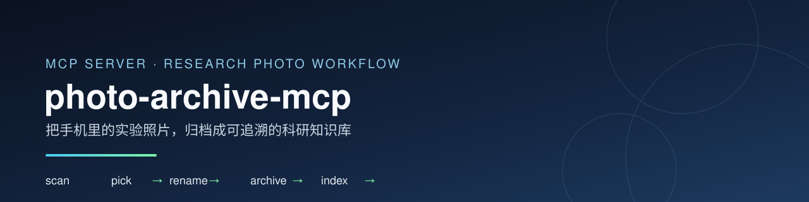
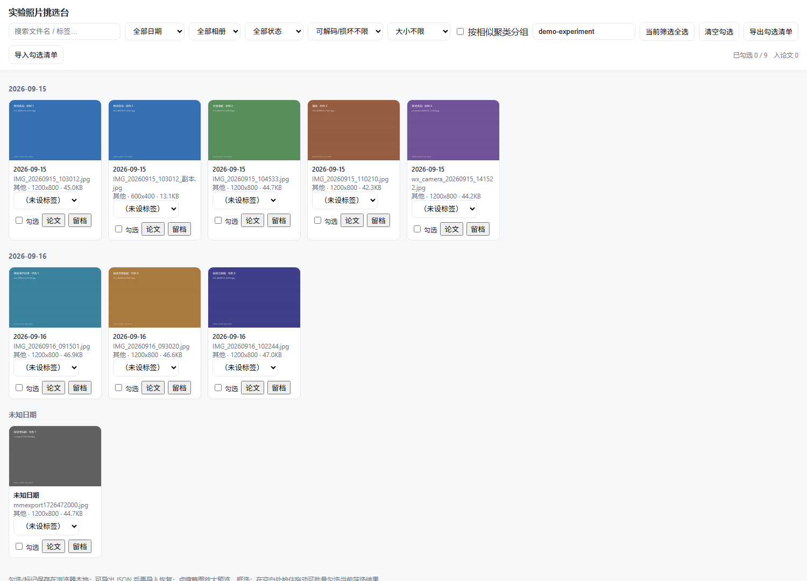
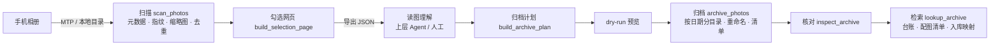

<div align="center">



**把手机里的实验照片，归档成可追溯的科研知识库。**

扫描 → 网页勾选 → 重命名归档 → 索引核对，全程本地跑；17 个 MCP 工具，直接接进 Claude、Cursor、Codex 等客户端。

[](https://github.com/gaoanze/photo-archive-mcp/actions/workflows/test.yml)
[](LICENSE)
[](pyproject.toml)
[](docs/USAGE.zh-CN.md)
[](CONTRIBUTING.md)

[English](README.en.md) · [完整手册](docs/USAGE.zh-CN.md) · [反馈问题](https://github.com/gaoanze/photo-archive-mcp/issues)

</div>

## 为什么会有这个项目

实验做久了，手机相册里会堆几千张照片：现场实拍、仪器读数、谱图、表格截图、微信传输图混在一起。想写论文的时候翻半天找不到，找到了也说不清是哪天、哪批样品。

`photo-archive-mcp` 把这些照片整理成**目录 = 日期 + 当日总结、文件名 = 日期 + 内容标签 + 编号**的结构化归档，同时生成清单、索引、对比报告和入库映射。之后写论文、复盘、交材料，按日期或关键词都能直接搜到。

## 它会做什么

| 你做实验时的痛 | 这个工具的处理 |
| --- | --- |
| 相册里几千张图，挑不过来 | 单文件「勾选网页」：缩略图预览、按日期/相册/大小/损坏状态筛选、框选批量勾选，离线可用 |
| 文件名没有任何信息 | 自动重命名成 `日期-标签-序号.jpg`，非法字符自动净化，编号稳定 |
| 说不清当天拍了什么 | 读图理解交给上层 Agent 或人工，结论写进计划的 `summary` / `tag`；工具只做确定性落地 |
| 重复、损坏混在一起 | SHA-1 指纹去重、pHash 相似分组、损坏与无法解码清单 |
| 归档后回不去 | 对照表、回滚清单、对比报告、照片索引、按关键词/日期/标签反向检索 |
| 跨实验一团乱 | 跨实验台账、入库目录映射、论文配图清单（自动编号 Fig.01） |
| 不想把实验数据传到云上 | 本地优先：不联网、不上传、不直接写远程仓库 |

## 演示

生成出的勾选网页（示例数据，9 张合成实验图，含 1 组近似重复、1 张无法识别日期）：



## 快速开始

```bash
git clone https://github.com/gaoanze/photo-archive-mcp.git
cd photo-archive-mcp

python -m venv .venv
.venv\Scripts\activate          # Windows
# source .venv/bin/activate     # macOS / Linux

pip install -e .                # Windows 想从手机直连取图：pip install -e ".[phone]"
```

接入 MCP 客户端（stdio，命令随安装方式调整）：

```json
{
  "mcpServers": {
    "photo-archive": {
      "command": "photo-archive-mcp",
      "args": []
    }
  }
}
```

不想接客户端也可以直接跑命令行演示：

```bash
python examples/selftest.py                                          # 合成样例端到端自测
python examples/cli_demo.py --source ./photos --out ./archive_ready  # 生成勾选网页 + 归档
python examples/cli_demo.py --source ./photos --out ./archive_ready --lookup 谱图   # 反查归档
```

## 工作流



## 17 个工具

| 阶段 | 工具 | 作用 |
| --- | --- | --- |
| 取图 | `list_phone_devices` · `clone_phone_photos` | Windows 走 MTP/WPD 断点续传；macOS/Linux 复制本地照片目录 |
| 扫描 | `scan_photos` | 递归扫描：日期、相册、尺寸、指纹、解码状态、重复与损坏清单 |
| 勾选 | `build_selection_page` | 生成内联数据的单文件勾选网页，可导出/导入勾选状态 |
| 计划 | `build_archive_plan` · `preview_archive_plan` | 合并勾选清单与标签，生成归档计划；dry-run 只出目录树 |
| 归档 | `archive_photos` | 按日期建目录、重命名、复制、写清单/索引/对比报告，支持增量 |
| 核对 | `inspect_archive` | 清点文件夹数、图片数、体积、清单索引是否齐全 |
| 检索 | `lookup_archive` · `draft_commit_message` | 按关键词/日期/标签反查；生成入库 commit message 草稿 |
| 选片 | `suggest_tags` | 按文件名/相册规则给标签建议，合并历史词表 |
| 治理 | `export_compressed` · `quality_filter` · `export_figures` | 压缩副本、模糊/过暗/过亮筛查、论文配图清单 |
| 衔接 | `update_ledger` · `query_ledger` · `target_mapping` | 跨实验台账、台账检索、知识库入库路径映射 |

完整参数、数据格式与边界见 **[完整手册](docs/USAGE.zh-CN.md)**。

## 设计上的几个取舍

- **不做 AI 读图**：判断照片内容需要多模态模型，各家客户端本来就有；本服务只负责可验证、可重复的确定性整理，避免"看起来整理好了、其实对不上"。
- **默认复制，不移动源文件**：归档目录和手机克隆目录互不影响，有对照表可回滚。
- **不直接写远程仓库**：归档在本地完成，是否入库、何时推送由你决定。
- **所有产物都是纯文本 JSON/Markdown**：方便 diff、git 管理和后续再加工。

## 文档

- [完整使用手册（中文）](docs/USAGE.zh-CN.md)：分步详解、工具参数、数据格式、命名规则、配置项、边界说明
- [English README](README.en.md)
- [CHANGELOG](CHANGELOG.md)

## 隐私与安全

- 照片和元数据只在本机处理，服务本身不发起网络请求、不上传任何文件。
- 仓库内不含作者私人信息；示例与测试用合成图片，路径均为占位符。
- 安全问题和敏感数据相关的报告方式见 [SECURITY.md](SECURITY.md)。

## 许可与声明

- **本仓库代码**：[MIT](LICENSE)。可商用、修改、再分发，保留版权与许可声明即可。
- **第三方依赖**（均为宽松许可，与 MIT 兼容；本项目不打包、不修改其源码）：
  - [`mcp`](https://pypi.org/project/mcp/)（MIT）——MCP Python SDK；
  - [`Pillow`](https://pypi.org/project/Pillow/)（HPND / PIL License）——图片解码、缩略图与质量指标；
  - [`pywin32`](https://pypi.org/project/pywin32/)（PSF License，仅 Windows 取图可选）。
- **仓库素材**：`assets/banner.svg` 为自制；`assets/demo-selection.png` 由脚本生成的纯色合成示意图渲染而成，不含真实照片、字体文件或第三方图片。
- **商标声明**：Claude、Cursor、Codex 等名称仅用于说明 MCP 客户端兼容性，商标归各自所有者；本项目与 Anthropic 及 Model Context Protocol 官方无隶属关系。“微信 / WeChat”仅作为照片来源的描述性标签出现。

## Roadmap

- [ ] 连拍/视频的序列分组
- [ ] 相似照片保留策略可配置（当前只分组不自动删）
- [ ] 更多取图后端：Android adb、iCloud 导出目录
- [ ] 勾选网页键盘快捷键与暗色主题
- [ ] 导出到 Zotero / Obsidian 的引用格式

## 参与贡献

欢迎 issue 和 PR：先看 [CONTRIBUTING.md](CONTRIBUTING.md)。提交前跑一遍：

```bash
python tests/test_core.py
python examples/selftest.py
```

## License

[MIT](LICENSE) © gaoanze

---

如果这个工具帮你省下了整理实验照片的时间，点个 ⭐ 就是最大的支持；也欢迎把这套归档流程推荐给同组同学。
